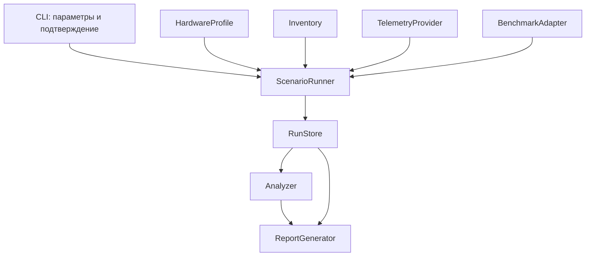

# CPU Lab: предложение архитектуры MVP

Дата: 20 октября 2026. **Архитектурный план, согласованный пользователем.**
Основание: [ТЗ](Codex_CPU_Lab_TZ.md) и [разведка](research.md).
После согласования реализован первый mock-этап; текущий статус и следующие шаги
зафиксированы в [plan.md](plan.md). Ниже описан целевой MVP, а не перечень уже
проверенных на железе возможностей.

Также реализован [предварительный CSV-импорт](hwinfo-csv.md). Он использует
отдельную модель точечных наблюдений: интервал измерения и границы нагрузки
из CSV пока не подтверждены, поэтому искусственно создавать интервальные
`Sample` и запускать расчёт энергии для таких данных нельзя.

Добавлен [процессный supervisor](process-supervisor.md): доверенный host с gate,
Windows Job Object и Linux process group, bounded output и отдельный process journal.
Проверка Linux выполнена на лёгких собственных процессах; Windows execution
и подключение к реальному BenchmarkAdapter остаются следующими этапами.

Сквозной [process-probe runner](probe-series.md) уже связывает лёгкую фикстуру
с supervisor, общим журналом, анализом, HTML и recovery. Его отдельный
ProbeBenchmarkAdapter использует реальное время процессов и синтетические баллы;
mock-runner с виртуальными часами сохраняет прежний контракт.
Живой provider и реальные нагрузки к этому пути пока не подключены.

## 1. Решение и существенные ограничения

Предлагается **C# / .NET 10 LTS, Windows x64, CLI**, один стек для orchestration,
инвентаризации, хранения, анализа и HTML. Self-contained portable сборка уменьшает
установку зависимостей, но требует обновления встроенного runtime вместе с приложением.
.NET 10 поддерживается до ноября 2028 согласно
[официальному lifecycle](https://dotnet.microsoft.com/en-us/platform/support/policy/dotnet-core).
Python и отдельный веб-сервер для MVP не нужны. GUI можно добавить поверх тех же сервисов.

Приоритет источников:

1. **HWiNFO Shared Memory** — основной кандидат для исследования effective clocks;
   окончательно принять после проверки ABI, условий и каталога на A.
2. **HWiNFO Pro CLI log** — дополнительный оригинальный CSV/JSON и альтернативный
   pipeline. Free CSV import полезен для старых данных, но не даёт автоматической
   live-защиты и не считается эквивалентом полного сценария.
3. **LibreHardwareMonitor 0.9.6** — необязательный provider ограниченного набора;
   не обещать Intel effective clocks и CEP flags. Отсутствие PawnIO не устранять
   автоматической установкой драйвера.
4. **Mock/Replay** — обязательный режим, полностью без аппаратного доступа и нагрузки.

Нагрузки: R23 MC ×3 после квалификации конкретной сборки; 7-Zip ×3 как конечная
свободно доступная альтернатива. y-cruncher/Prime95/OCCT — последующие адаптеры,
не необходимые зависимости MVP. Обоснование и первоисточники — в исследовании.

CPU Lab не меняет настройки CPU, BIOS или ОС. Сторонние исполняемые файлы, ключи,
драйверы и прошивки не входят в distributable. Пользователь указывает существующие
установки один раз; версии и хеши фиксируются, обновления требуют нового preflight.

## 2. Путь пользователя и цена ручных действий

| Когда | Что делает пользователь | Что выполняется автоматически |
|---|---|---|
| Первичная подготовка, без BIOS | Распаковать CPU Lab; указать пути к HWiNFO и R23/7-Zip; принять лицензии сторонних программ; включить SHM/Sensors, если выбран этот путь | Проверка файлов, версий и прав; inventory; каталог сенсоров; сохранение конфигурации |
| Первичная калибровка | Только при неоднозначности один раз сопоставить канал/единицу; подтвердить ограниченный пакет тестов | 30–60 s проверки потока, mapping, fixture stdout, проверка отмены и отчёта |
| После ручной смены BIOS | Загрузить Windows; один запуск CPU Lab; ввести изменившиеся AC/DC/LLC/CEP и примечание одним блоком | Свежая inventory, сравнение со старой, загрузка предыдущих значений с пометкой unconfirmed |
| Перед серией | Одно подтверждение теста, числа повторов, таймаутов и порога температуры; возможен UAC стороннего провайдера | Сохранение конкретного плана; проверка свежих сенсоров; idle/warmup |
| Во время серии | **0 кликов** при штатном выполнении | Три запуска, паузы, окна, поток samples, watchdog, partial logs |
| После серии | Открыть автоматически подготовленный report | Агрегаты, сравнение, CSV/JSON и standalone HTML |

Подтверждение можно сохранить для заранее утверждённого неизменного пакета с лимитами.
Смена бинарника, сценария или лимитов делает прежнее подтверждение неприменимым.
Число UAC/ручных действий зависит от выбранной установки HWiNFO; нулевой UAC не обещаем.
Не включать автоматический запуск при входе в ОС и не создавать scheduled tasks в MVP.

Одно редактирование BIOS → одна загрузка Windows → одна сессия со всеми повторами.
Для подготовки адаптеров дополнительная перезагрузка BIOS не нужна. Переключение
A→B требует нового inventory и mapping; ядро приложения не меняется.

## 3. Модули и направление зависимостей



Небольшие логические модули; не микросервисы. На старте достаточно CLI-проекта,
библиотеки ядра, адаптеров и тестового проекта. Journal/analysis не зависят от CLI.

| Модуль | Ответственность | Контракт, проектируемый до кода |
|---|---|---|
| Inventory | SKU, BIOS, плата, ОС, topology, версии | Snapshot полей с provenance и raw evidence; unknown допустим |
| HardwareProfile | Описательные особенности A/B, единицы и подсказки | Не исполняет команды настройки; не хранит жёсткий сценарий платы |
| TelemetryProvider | Probe, catalogue, поток, health, закрытие | Capabilities и SampleBatch с source time/receipt time; без управления железом |
| BenchmarkAdapter | ValidateInstall, BuildPlan, запуск, события, ParseResult, остановка | Известный exe и безопасные argv; версия parser; score и причины отсутствия |
| ScenarioRunner | Состояния сессии, таймеры, повторения, отмена | Единственный владелец запуска нагрузки; confirmed immutable plan |
| RunStore | Append raw/events, metadata checkpoints, recovery | Запись не зависит от report/UI; schema version и атомарные manifest updates |
| Analyzer | Окна, качество, интегралы, агрегаты, сравнение | Чистые вычисления по сохранённым данным, неизвестное не заменяется нулём |
| ReportGenerator | Самодостаточный HTML, экспорт | Не обращается к живым сенсорам и не запускает процессы |

Provider не передаёт библиотечные объекты в Analyzer. Унифицированные поля:
`metric_key`, `sensor_key`, `provider/version`, `unit`, `scope`, `core_type`,
`logical_cpu/core_id`, `timestamp`, `interval_start/end`, `value`, `validity`,
`reason`, `raw_reference`. Перечень capabilities динамический и сохраняется в сессии.

## 4. Модель доказательств и настройки

Каждое значение имеет `value`, `unit`, `origin`, `source`, `observed_at`, `status`.
`origin`: `measured`, `user`, `inferred`, `unknown`.
`status`: `valid`, `unconfirmed`, `unavailable`, `stale`, `invalid`.
`source` — WMI property, provider ID, ручной ввод или правило вывода.

Предыдущее AC=0.60 из другой сессии загружается как `user/unconfirmed`.
После одного подтверждения становится текущим `user/valid`, но не `measured`.
При смене BIOS/платы не переносить настройки молча. Для неизвестного CEP хранить
null и причину, не false. BIOS, raw microcode и нормализованная microcode — разные поля.

Описание сценария — JSON с версией схемы, adapter/mode, repeat=3, idle/warmup,
cooldown, target sample interval, per-run и total timeout, температурным порогом,
policy потери telemetry, threads/dictionary или R23 minimum duration.
Фактический executable hash/argv/provider mapping снимком входят в план сессии.
Это целевая схема; реализованный mock-поднабор описан в [development.md](development.md).

У hardware-полей отдельно хранить:

- `supported` — возможность CPU/провайдера;
- `reported` — прочитанное значение или введённая настройка;
- `applied` — подтверждение фактического применения, если есть;
- `observed_effect` — измерение результата, а не подтверждение самого регистра.

## 5. Время и надёжность окон измерения

Записывать UTC ISO 8601, исходное время провайдера, local UTC offset и монотонные
тики Stopwatch. Системные часы могут корректироваться: длительности считает
монотонный таймер. Для HWiNFO CSV сохранять locale/date/time как есть, нормализацию
выполнять только с известной зоной. Не придумывать миллисекунды, которых нет в источнике.

`process_window`: создание/старт и окончательное завершение дерева нагрузки.
`load_window`: подтверждённые adapter markers либо оценка по CPU usage, явно `inferred`.
Внутренние паузы между renders сохраняются. Нельзя незаметно исключать слабые интервалы,
чтобы улучшить среднюю мощность. Сохранять и полное process window, и load-сегменты.

Для interval-based power/effective clocks хранить окно усреднения. Сэмпл, пересекающий
границу теста, нельзя считать полностью принадлежащим нагрузке. Консервативно использовать
полностью вложенные интервалы; оценку с пропорциональным перекрытием выводить отдельно
и маркировать как предположение. Широкие gaps не интерполировать для статистики.

Preflight: предложенный опрос 1 s, минимум 30 свежих интервалов; проверить units,
монотонность, median/p95 interval, пропуски и overhead. Это стартовая политика,
а не аппаратный стандарт; её нужно проверить на A. Предварительная граница gap —
более 3 ожидаемых периодов. У frozen потока контролировать provider heartbeat/time,
а не изменение значения: постоянная температура сама по себе не означает сбой.

Для R23 отсутствие точных маркеров не блокирует журнал и score, но ограничивает
заявления о мощности «именно во время рендера» и об эффективности. Этот риск
фиксируется в отчёте и критериях приёмки, а не скрывается за process timestamps.

## 6. Хранилище и восстановление

```text
runs/YYYY-MM-DD_HH-mm-ss_<slug>_<session-id>/
  metadata.json             # inventory, provenance, versions, units, schema
  scenario.json             # фактически утверждённый план
  sensors.json              # catalogue, mapping, topology
  samples.csv               # нормализованный long format
  benchmarks.json           # результаты и ссылки на окна/артефакты
  events.jsonl              # append-only состояния, ошибки, checkpoints
  raw/                      # оригинальный provider log / SHM snapshots
  attempts/<attempt-id>/    # stdout, stderr, process info, sample references
  report.html
```

Session ID отличает запуск программы; attempt ID отличает каждый повтор/ошибку.
Для каждого attempt сохранить собственный telemetry slice с ссылкой на непрерывный
raw поток и диапазон offsets/timestamps; общий файл не заменяет принадлежность к прогону.
SHM raw означает сохранённые исходные снимки с каталогом и версией ABI, не лог,
который якобы создал HWiNFO. Дисковое место проверяется до запуска.

Файлы stdout/stderr и raw пишутся потоково; события и samples сбрасываются регулярно,
например раз в секунду, с документированным пределом потери при аварии питания.
Не обещать абсолютную сохранность не успевших записаться данных. Manifest заменяется
атомарно через временный файл. При повторном старте незакрытая сессия становится
`interrupted`; не дописывать её как новый успешный прогон. Не запускать нагрузку
автоматически при восстановлении. Report можно восстановить из сохранённых файлов.

Шесть точек ТЗ импортируются как `legacy/manual`, `raw_available=false`, без
выдуманной даты, mean power и временных рядов. В том числе AC90/DC90 и AC60/DC90
сохраняют score, peak W и max °C, но не попадают в расчёт points/mean W.

## 7. Runner, отмена и предохранители

Состояния: `created → preflight → awaiting_confirmation → baseline → warmup? →
running → cooldown → running… → finalizing → completed`.
Из каждого активного состояния возможны `cancelled`, `failed`, `timeout`, `interrupted`.
Ошибка одного повтора сохраняет результат; по умолчанию тяжёлая серия не продолжается
после серьёзной ошибки/утраты аварийной telemetry. Нет бесконечных retries.

Реальная нагрузка получает per-run и total wall timeout, а также ограниченное число
повторов. Для примера R23 minimum=180 s можно предложить timeout=360 s на повтор,
но подтвердить его после пилотного запуска; minimum duration не верхняя граница.
Cooldown ограничен по времени даже если желаемая температура не достигнута.
Температурный порог задаёт оператор перед пакетом, без придуманного «безопасного» числа.

На Windows использовать Job Object с завершением принадлежащего дереву процесса при
закрытии job. Для cmd/start обвязки проверить, что дочерний Cinebench не покидает job.
Graceful stop с коротким grace period, затем kill дерева и сохранение partial stdout.
Не завершать чужой HWiNFO/ThrottleStop и не делать kill по одному имени executable.
Отдельный watchdog контролирует зависание runner. Если live temperature недостоверна,
показывать ограничение; для диагностического сценария требовать свежий аварийный канал,
иначе отказ до старта. Если telemetry пропала во время нагрузки — остановить её.

CPU Lab не отменяет встроенные аппаратные защиты и не заменяет их. Он не снимает
ограничения HWiNFO и не включает SHM заново циклически ради обхода лицензии.

## 8. Анализ и отчёт

Сначала качество, затем числа: score validation, доля coverage, gaps, stale,
окно и его происхождение, фон, длительность и версии. Mean package W считать по
времени валидных интервалов; отдельно duration/coverage. Median и observed max
не объявлять аппаратными пиками. Energy — интеграл мощности в согласованном окне.

P/E clocks показывать отдельно и по ядрам. Не удваивать вес P-core из-за SMT:
если источник per-thread, сначала явно объединить siblings в physical-core metric,
затем усреднить ядра; сохранить исходные каналы и метод. Неизвестная topology →
без искусственной P/E классификации. Сравнение core/effective валидно только на
согласованных окнах и с высокой загрузкой; ratio не получает ярлык «процент CEP».

По серии: все индивидуальные результаты, mean/median, min/max, standard deviation,
coefficient of variation для сопоставимых завершённых прогонов; число valid/failed.
Из трёх повторов не делать сильных статистических выводов. Фон не вычитать из package
power автоматически и не убивать процессы. Предупреждение о фоне — не запрет по умолчанию.

Points/mean W разрешать только при сопоставимом benchmark и достаточно подтверждённом
окне; указать, что метрика не измеряет wall energy. При приблизительном load window
число подавлять либо выдавать отдельной экспериментальной оценкой, не главным итогом.

HTML содержит system/provenance, условия, timeline с границами попыток,
power/temperature/core/effective curves, flags, индивидуальные score и quality,
сравнение с выбранным baseline и предыдущей совместимой сессией. Legacy показывать
отдельной таблицей неполных данных. Сравнение A/B допустимо рядом, но не выдаётся за
парный эксперимент одной машины. Смена BIOS/test/provider/threads отмечается явно.

Отчёт самодостаточен: встроенные CSS/JS/данные, никаких CDN/обязательного сервера.
Для MVP достаточно таблиц и встроенных SVG-графиков; сложная chart-библиотека не нужна.
Экранировать HTML и пользовательские строки; ссылки только на собственные артефакты.

## 9. Поэтапный план и проверяемые ворота

| Шаг | Результат | Проверка / критерий перехода | Ручная работа |
|---|---|---|---|
| 0 — сейчас | research.md + architecture.md | Обоснование адаптеров, неизвестные отмечены | Ознакомление и согласование плана |
| 1 — контракты и mock | Schema, journal, runner/replay, partial/recovery, legacy import | Три mock attempt, отмена/ошибка, валидный автономный report; никаких нагрузок | 0 действий на железе |
| 2 — inventory и provider qualification | HWiNFO catalogue/SHM; CSV import; health | Реальные units/P/E/effective, stale/gap detection, происхождение значений; ABI и licensing закрыты | Одна настройка HWiNFO; без BIOS |
| 3 — конечная нагрузка | 7-Zip adapter | Сначала fixtures; после согласования один ограниченный запуск, затем ×3; timeout/отмена дерева | Одно подтверждение пакета |
| 4 — R23 qualification | Версия/EULA/stdout parser и окна | Один MC score на attempt; правильный stdout capture; выявлены process/load boundaries или честная оценка | Первый запуск/EULA; одно подтверждение |
| 5 — диагностический MVP A | R23×3 + непрерывная telemetry + сравнение legacy | Все критерии ТЗ; эффективные P/E при наличии; отчёт о качестве и причинах отсутствия | Один ввод настроек и запуск после каждого BIOS |
| 6 — перенос на B | Новый HardwareProfile/inventory | i7-14700KF, точная плата/BIOS из фактов; ядро без изменений | Разрешение владельца и первичная настройка |

LHM, y-cruncher, Prime95, GUI и IFR — после основного потока, по необходимости.
Не считать задачу измерения CEP решённой, если effective clocks недоступны или R23
не имеет достаточно определённого окна: журнал остаётся полезным, диагноз — unknown.

Проверки реализации после согласования: parser fixtures (locale, encoding, повреждённые
строки, отсутствующий score, повторный score); gaps и окна с известным интегралом;
ручные/inferred/unknown значения; frozen provider; отмена до старта/во время нагрузки;
kill дочернего процесса; восстановление partial сессии; несовместимый baseline;
HTML escaping и отсутствие внешних ресурсов. Mock sample-run должен воспроизводиться
на машине без Windows-драйверов. Реальные stress-тесты никогда не входят в обычный CI.

## 10. Что требуется согласовать

Предложенный объём: .NET CLI, журнал/отчёт/mock, HWiNFO как основной provider,
7-Zip как запасная нагрузка, R23 как основной исторически сопоставимый benchmark.
Этот объём согласован; аппаратная квалификация выполняется отдельно. Лицензия CPU Lab
выбирается отдельно до публичного релиза; сторонние licenses не определяют её автоматически.
Наличие Pro и доступность стенда влияют на аппаратную квалификацию, но не мешают
реализовать затем mock-first ядро. На этой стадии блокирующих вопросов к пользователю нет.
