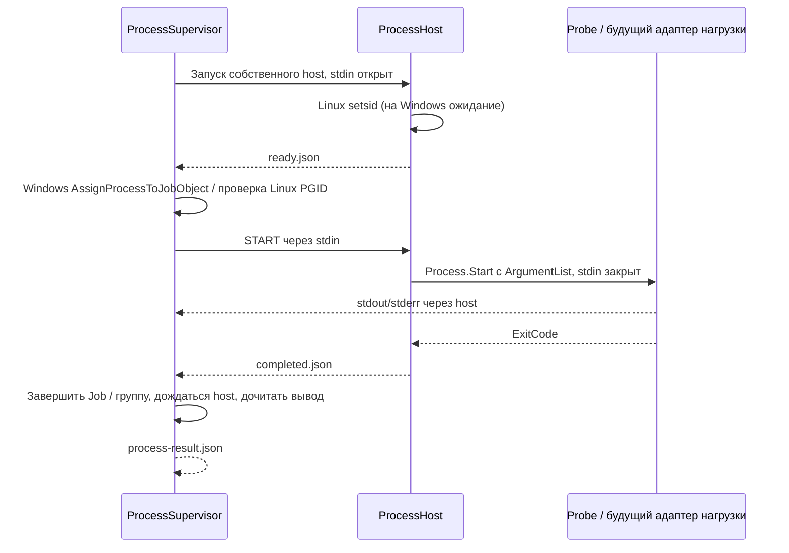

# Управление процессами без стенда

Этап 20.10.2026. Реализованы запуск, параллельный сбор stdout/stderr,
ограничение времени и объёма вывода, отмена и завершение дерева.
Проверено на Linux с собственными лёгкими процессами. 22.10 дополнительно
исполнено на одном Windows 11 стенде: Job Object, тесты и CLI прошли;
подробности и границы — в [validation.md](validation.md). Удалённый CI не запускался.
Подключение R23, 7-Zip и других нагрузок — отдельный последующий шаг.

## Демонстрация

```bash
dotnet build CpuLab.sln --configuration Release --no-restore
dotnet run --project src/CpuLab.Cli --configuration Release --no-build -- process-demo
```

CLI запускает только комплектный `CpuLab.ProcessProbe` в режиме echo:
выводит две строки и завершает работу. Лимит времени 10 секунд.
При необходимости `--output <каталог>` меняет место сохранения артефактов.
Произвольная команда через CLI не принимается; управление другими executable
доступно как внутренний API для будущих адаптеров.

## Схема



Host — небольшой доверенный помощник из этого же проекта. Он не создаёт
целевой процесс до `START`. Это устраняет промежуток, в котором обычный
`Process.Start` мог бы породить потомков до включения в Job Object.
Неподходящая среда/отказ назначения Job не приводят к запуску нагрузки.

Используются штатные `System.Diagnostics.Process`, `ArgumentList` и нативные
API ОС. Shell не запускается, склейки аргументов в командную строку вручную нет.
Код и DLL сторонних обёрток не копировались, новых NuGet-зависимостей нет.

## Остановка и результат

Windows: собственный ненаследуемый Job с `JOB_OBJECT_LIMIT_KILL_ON_JOB_CLOSE`,
без разрешения breakaway. Host и его потомки входят в него. Остановка —
`TerminateJobObject`, затем ожидание `ActiveProcesses == 0` до 5 секунд.
При аварии владельца закрытие последнего handle обеспечивает системную остановку.
Поддержка вложенного Job зависит от текущего окружения и проверяется назначением.

Linux: host создаёт новую сессию/группу через `setsid`; supervisor проверяет PGID
и отправляет `SIGKILL` только своей группе. После завершения основной программы
host остаётся жив до уборки, сохраняя идентификатор группы. EOF управляющего stdin
сообщает host о потере владельца; host завершает собственную группу.
Статус `linux-group-kill-requested` означает успешную отправку сигнала, а не
доказательство, что ОС уже убрала все записи процессов.

Linux-режим предназначен для разработки: авария самого host или намеренный выход
потомка из группы не покрыты гарантией Windows Job. Тесты отдельно проверяют,
что известные PID фикстуры прекратили выполнение; zombie в контейнере считается
завершившим выполнение, но его reaping остаётся обязанностью родителя/init.

Лимит времени отсчитывается монотонным `Stopwatch`/таймером начиная с запуска
процедуры, включает старт host. Допустимы 50 ms…2 часа. Отмена до старта
не создаёт процесс. После отмены/таймаута отдельно выполняется уборка;
ожидание Job, host и дренирование потоков ограничены по 5 секунд.
Это лимит длительности запуска с последующим ограниченным временем уборки.

На каждый поток отдельно задан лимит, по умолчанию 8 MiB (1 KiB…128 MiB).
Байты пишутся без декодирования и изменения переводов строк. При превышении
лимита сохраняется префикс и запускается остановка; статус `output-limit`.
Оба потока читаются одновременно, чтобы не зависнуть на заполненной трубе.

Статусы: `completed`, `failed`, `start-failed`, `cancelled`, `timeout`,
`output-limit`, `capture-failed`, `cleanup-failed`.
ExitCode берётся только из подтверждённого завершения **целевой программы**,
а не из кода принудительно завершённого host. При таймауте/отмене он обычно null.
Нулевой код не доказывает валидность бенчмарка: будущий адаптер обязан проверить
результат. Очистка оставшихся потомков выполняется и после нулевого кода.
При ошибке уборки успешный статус не возвращается.

## Файлы

Каждый вызов создаёт отдельный `runs/process_<uuid>/`:

- `command.json`: executable, отдельные аргументы и рабочий каталог;
- `supervision.json`: лимиты, host и выбранный механизм containment;
- `ready.json`, `target.json`, `completed.json`: служебные сведения host;
- `stdout.bin`, `stderr.bin`: исходные байты, включая частичный вывод;
- `process-result.json`: конечный статус, root PID/exit, время, статус уборки,
  размер сохранённых потоков и признак усечения.

Команда содержит переданные аргументы, поэтому адаптеры не должны передавать
секреты в argv. `runs/` исключён из Git. Файлы протокола пишутся временным файлом
и переименованием; чтение производится раз в 20 ms. Это внутренний протокол
между доверенными компонентами, не граница изоляции для враждебного executable.
Длительности процессов не являются подтверждёнными окнами рендера/измерения.

После принудительной смерти supervisor может остаться каталог без
`process-result.json`; это частичный журнал, его нельзя считать успешным.
Восстановление таких каталогов в `recover` пока не добавлено.
Гарантий сохранения последних буферизованных байтов при аварии/отключении питания нет.

## Проверки и следующие шаги

Автотесты запускают собственный probe: echo, код 7, короткую запись в оба потока,
ожидание, создание одного потомка, ранний выход родителя. Максимальное ожидание
probe — 30 секунд; busy-loop и вычислительных нагрузок нет.
Покрыты аргументы с пробелами/кавычками/Unicode, stderr, ограничение вывода,
отмена до старта и после создания потомка, timeout, root exit с живым потомком,
аварийная смерть владельца, отсутствующий executable и ошибка старта.

Windows-исполнение выполнено 22.10 на одном стенде. Далее: оформить интеграцию с адаптерами
и журналом сессии, учесть версию/хеш нагрузки и согласованный пользователем пакет;
добавить квалификацию реальных exit/stdout и границ теста.
Build копирует host/probe рядом с CLI и тестами автоматически. Portable publish
и self-contained packaging пока не настроены.

Первоисточники, проверены 20.10.2026:

- [Job Objects](https://learn.microsoft.com/en-us/windows/win32/procthread/job-objects)
- [AssignProcessToJobObject](https://learn.microsoft.com/en-us/windows/win32/api/jobapi2/nf-jobapi2-assignprocesstojobobject)
- [Extended limits ABI](https://learn.microsoft.com/en-us/windows/win32/api/winnt/ns-winnt-jobobject_extended_limit_information)
- [Accounting ABI / ActiveProcesses](https://learn.microsoft.com/en-us/windows/win32/api/winnt/ns-winnt-jobobject_basic_accounting_information)
- [Process.Kill: ограничения ожидания потомков](https://learn.microsoft.com/en-us/dotnet/api/system.diagnostics.process.kill)
- [setsid](https://man7.org/linux/man-pages/man2/setsid.2.html), [kill группы](https://man7.org/linux/man-pages/man2/kill.2.html)
