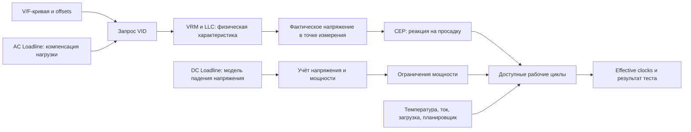

# CPU Lab: фаза 0 — техническая разведка

Дата проверки: **20 октября 2026**. Основание: [ТЗ](Codex_CPU_Lab_TZ.md).
Статус: изучены первоисточники и исходный код; **реализация не начата**.

## 1. Что действительно проверено

В этой сессии доступно Linux-окружение проекта, а не Windows-стенд A.
Не запускались бенчмарки, драйверы, MSR-команды или прошивки. Поэтому:

- **DOC** — подтверждено документацией производителя/автора;
- **SRC** — проверено чтением конкретной версии исходников;
- **HW pending** — требуется проверка на целевой машине;
- **гипотеза** — возможное объяснение, которое нельзя считать результатом измерения.

Сведения о стендах и старых прогонах взяты из ТЗ: это пользовательские данные,
а не новая автоматическая инвентаризация. В каталоге проекта нет скриншотов BIOS,
исходных HWiNFO-логов или установленного R23. Не запрашиваем повторные скриншоты:
для первого этапа достаточно будущей выгрузки сенсоров и инвентаризации из ОС.

Проверенные снимки исходников (скачаны в `/tmp`, в проект не включены):

| Проект | Версия / commit | Что прочитано |
|---|---|---|
| LibreHardwareMonitor | v0.9.6, `3d331e3370efb858411f19511373eff65a218701` | `IntelCpu.cs`, CPU-каталог, `PawnIo/IntelMsr.cs`, `PawnIo.cs`, README, csproj, LICENSE, THIRD-PARTY-NOTICES |
| CinebenchBatch | `f17d1d92f33e4a206cadf9c4d7b3ed3fcfbb808e` | весь `CinebenchBatch.cmd`, README, LICENSE |
| agoose77/throttlestop | `6c3e3ca39ef6f5165dfaf892ac358a7c4dfa59d5` | `msr.py`, `__main__.py`, MIT license |
| 7-Zip | 26.04, `9128b80e3a471108678e2b3ec3c985861c8d7b0f` | версия, CLI parser, `BenchCon.cpp`, части `Bench.cpp`, лицензия |
| y-cruncher | официальный zip v0.8.7.9547b | прочитан вложенный `Command Lines.txt`, без запуска exe |
| IFRExtractor-RS | Cargo version 1.6.1, `b1b9b36c00e3209ff0b1d2a76f10cb17e339473d` | README, Cargo.toml, лицензия репозитория |

Релизы на официальных страницах: HWiNFO **8.54** (beta 8.55-6095 не выбираем),
LHM **0.9.6**, y-cruncher **0.8.7.9547b** (GitHub releases API подтверждает tag),
7-Zip **26.04**, Prime95 **30.19 build 20**.
Точная локальная сборка R23 неизвестна; нельзя объявлять её проверенной 23.200.
Версия OCCT не зафиксирована: проверена редакция Enterprise, не бинарный пакет.
Источники: [HWiNFO](https://www.hwinfo.com/download/),
[LHM](https://github.com/LibreHardwareMonitor/LibreHardwareMonitor/releases),
[y-cruncher](https://github.com/Mysticial/y-cruncher/releases),
[7-Zip](https://www.7-zip.org/download.html), [Prime95](https://www.mersenne.org/download/).

## 2. Концептуальная карта



Это качественная схема, а не формула управления конкретного BIOS.

| Понятие | Смысл и границы интерпретации |
|---|---|
| VID | Запрошенное CPU напряжение для рабочего состояния. Не показание физического напряжения на кристалле. |
| Vcore / VR VOUT | Измерение конкретного канала платы/VRM. Точка измерения, фильтрация и погрешность различаются; название Vcore недостаточно. |
| V/F | Зависимость целевого напряжения от частоты; offset может менять запрос, если механизм разрешён и применяется. Наличие поля не доказывает применения. |
| AC Loadline | Параметр компенсации нагрузки в расчёте запроса напряжения. Его снижение может уменьшить запрос под нагрузкой; результат зависит от платформы. |
| DC Loadline | Описание статического падения напряжения для модели CPU; несогласованность с реальной характеристикой VRM способна исказить учёт мощности. Это не независимый ваттметр. |
| LLC | Регулировка характеристики VRM и падения напряжения при токе. Номера уровней разных производителей несопоставимы. |
| CEP | Встроенная защита: по описанию Intel отслеживает просадку и внутренне ограничивает CPU. Нельзя выводить её активность только из падения баллов. |
| PL1/PL2, ток, температура | Разные причины ограничения производительности; значение лимита и факт его срабатывания — отдельные поля. |
| Core Clock | Дискретный снимок частоты/множителя. Может пропускать быстрые изменения и периоды отсутствия работы. |
| Effective Clock | Среднее за интервал с учётом времени сна; низкое значение при простое ожидаемо и само по себе не означает CEP. |

Основания: [Intel datasheet 743844](https://cdrdv2-public.intel.com/743844/743844-015.pdf),
[Intel: CEP](https://edc.intel.com/content/www/us/en/design/products/platforms/details/raptor-lake-s/13th-generation-core-processors-datasheet-volume-1-of-2/014/014/current-excursion-protection-cep/),
[автор HWiNFO об effective clocks](https://www.hwinfo.com/forum/threads/effective-clock-vs-instant-discrete-clock.5958/).
Названия BIOS и доступность каналов на A/B — HW pending.

### Какие признаки различают гипотезы

| Гипотеза | Что искать синхронно в окне нагрузки | Чего недостаточно |
|---|---|---|
| CEP / подавление рабочих циклов | Падение effective clocks и throughput при похожих обычных clocks и высокой нагрузке; доступный прямой статус защиты; исключение остальных лимитов | Только Core Clock, только max; один EDP/Other-флаг без расшифровки |
| Thermal limit | Температура относительно TjMax, текущий thermal throttling, совпадение во времени с потерей скорости | Исторический sticky-флаг, максимум за всю сессию |
| Power limit | Package Power относительно PL, текущие power-limit flags и их длительность | Одно значение PL1/PL2 либо краткий пик |
| Current/VR limit | Доступные current/EDP/VR flags, ток и температура VRM, если датчики есть | Автоматически считать любой EDP Other признаком CEP |
| Фоновая нагрузка / планировщик | CPU time дерева теста, общая и поядерная загрузка, фоновые процессы, P/E распределение | Низкая effective frequency на незагруженном ядре |
| Ошибка учёта мощности | Изменение источника/калибровки DC, несогласованность каналов VID/VOUT/мощности | Равенство VID и Vcore либо доверие RAPL как показанию розетки |
| Ошибка методики | Разная версия/длительность теста, прогрев, приоритет, число потоков, неполное окно, пропуски | Сравнение только двух итоговых чисел |

По шести ручным точкам CEP остаётся гипотезой. В диапазоне AC 0.90→0.60
балл падает примерно на 5.1%, peak power на 12.2%; 0.90→0.50 — примерно
26.2% и 23.4%. Это описание наблюдений, не вычисление энергоэффективности:
средней мощности и согласованных временных рядов нет.

## 3. Что доступно на стенде A

| Есть сейчас по ТЗ | Можно проверить в ОС | Только после перезагрузки BIOS | Не подтверждено |
|---|---|---|---|
| i5-13600KF, P6+E8, Gigabyte B760 GAMING X DDR5 rev.1.0 | CPUID, SKU, stepping, P/E topology; SMBIOS платы | Изменение конфигурации ядер в рамках отдельного согласования | Совпадение SMBIOS revision с надписью на плате |
| BIOS F18; строка microcode `137` | Версия/дата BIOS; raw revision от надёжного провайдера | Изменение BIOS-настроек, если понадобится позже | Основание записи `137`: не преобразовывать автоматически в `0x137` |
| PL1/PL2 181/181 W в старом отчёте | Текущие доступные лимиты и причины их срабатывания | Изменение BIOS power limits — вне MVP | Что лимиты сейчас те же |
| AC/DC 0.900/0.900 mΩ в исходном отчёте, последующие ручные точки | Проверить, экспортирует ли провайдер эти поля; сохранить происхождение | Ввод новых AC/DC, LLC и offsets — вручную пользователем | Надёжный универсальный OS readback AC/DC/LLC; единицы BIOS для каждого поля |
| Undervolt Protection Enabled; offsets ранее не действовали | Свежий отчёт о защите, наличие каналов напряжения и частот | Изменение firmware-политик — вне MVP | Действующий undervolt на F18; причина блокировки |
| CEP не доказан; явный пункт не найден на имеющихся скриншотах | Текущие exported flags и effective clocks | Осмотр BIOS пользователем только при необходимости | Отсутствие CEP-пункта вообще; возможность отключения и эффект |
| Шесть результатов R23 | Импорт как legacy/manual | Для первичной инвентаризации перезагрузка не нужна | Восстановление старых временных рядов невозможно |

Страница [Gigabyte для точной модели](https://www.gigabyte.com/Motherboard/B760-GAMING-X-rev-10/Support)
содержит поддержку BIOS Settings в HWiNFO, но это **не** подтверждение экспорта
AC/DC/CEP через CSV/SHM. [Сообщение Gigabyte](https://www.gigabyte.com/press/news/2101)
не заменяет проверку каталога сенсоров на F18. Стенд B не конкретизируем сверх ТЗ.

## 4. Матрица инструментов

Частота ниже — интерфейс или предлагаемый режим опроса, не обещанная точность.

| Источник | Интерфейс | Датчики / результат | Частота | Запуск | Ограничения | Лицензия | Статус |
|---|---|---|---|---|---|---|---|
| HWiNFO64 8.54 | Pro CLI CSV/JSON; SHM отдельно | clocks/effective, power, T, VID, доступные voltage/limits | Pro `-poll_rate` в ms; начать с 1000 ms | Pro `-l…`; free — Sensors + SHM | Фактические каналы A неизвестны; SHM не содержит всех GUI aggregates | Proprietary; personal/noncommercial free, Pro для CLI | DOC; HW pending |
| HWiNFO SDK | DLL/API | Inventory и мониторинг | По запросу, договор/SDK | Headless integration | Не бесплатная гарантия; нужны условия поставщика | Отдельное согласование | DOC; SDK не получен |
| LHM 0.9.6 | .NET Computer/IHardware/ISensor | Intel clocks, DTS temperature, RAPL power, voltage из PERF_STATUS | Вызывает приложение через Update | Внутри процесса | Нет нужного Intel effective/limit набора; PawnIO/права | MPL-2.0 + third-party terms | SRC; HW pending |
| Cinebench R23 | CLI + stdout | MC/SC score текстом | На завершении | g_CinebenchCpuXTest | Нет проверенного JSON API и точных render markers | Proprietary Maxon; EULA пакета pending | SRC внешней обвязки, DOC текущего Cinebench; R23 HW pending |
| CinebenchBatch | Windows cmd | Повторы и строки CB | По завершении всех повторов | script count | Нет полноценной валидации, таймаутов, окон и отмены | GPL-3.0 | SRC |
| y-cruncher 0.8.7.9547b | bench/config CLI | Тайминги, сообщения проверки | На завершении/этапах | bench 500m либо сохранённый config | CPU+RAM; конфигурации зависят от версии | Бесплатно noncommercial/academic, commercial согласуется | DOC пакетного manual; Windows pending |
| Prime95 30.19 b20 | `-t`, `-Wdirectory`, конфиги | Torture progress/errors/results.txt | В ходе теста | Отдельный рабочий каталог | Torture непрерывный; внешняя остановка не естественное завершение | Freeware/EULA GIMPS, не объявлять MIT/GPL | DOC; пакет pending |
| OCCT Enterprise | Command Line Edition, отчёты | Stress/benchmark/monitoring | Зависит от сценария | Отдельный коммерческий CLI | Публичного стабильного API и бесплатного CLI не подтверждено | Proprietary commercial | DOC редакции, синтаксис/версия pending |
| 7-Zip 26.04 | CLI `b` | MIPS, compression/decompression, CPU usage, итог | Конечный процесс | `7z.exe b 1 -mmt=20 -md=24` | Иной профиль нагрузки, не замена score R23 | LGPL-2.1-or-later, BSD и unRAR restriction для частей | SRC; Windows pending |
| ThrottleStop Windows | GUI/config/log, API не подтверждён | Не выбран для измерений | Не определена | Вручную; не включать в runner | Нет найденного официального открытого исходника/SDK | Freeware, не MIT | Первичный download недоступен, не проверено |
| agoose77/throttlestop | Python/Linux, rdmsr/wrmsr, JSON | MSR power/voltage/temperature fields | Разовые команды | Linux CLI | Включает записи даже для voltage query | MIT | SRC; не использовать на стенде |
| Intel PCM | C++ API/CLI | PMU, IPC, energy, частоты по доступности | Настраиваемая | Отдельные utilities | Windows driver; программирование PMU регистров; не plug-and-play read-only | BSD-3-Clause | DOC; отложить |
| WMI + CPU Sets + CPUID | Windows API | Inventory, topology, OS load | Inventory один раз, load периодически | Встроенный сбор | Не дают универсальные Vcore/CEP/AC/DC | API ОС, сторонний движок не нужен | DOC; HW pending |
| UEFITool / IFRExtractor | Offline binary parsing | Формы/строки/условия BIOS | Не поток | Официальный образ → извлечение → декодирование | Формы не доказывают видимость/применение | BSD-2-Clause; лицензия образа отдельно | DOC/SRC; образ F18 не разбирался |

## 5. HWiNFO: что можно автоматизировать

Автор документирует для Pro `-lMySensors.CSV`, `-log_format=1`, `-poll_rate=n`,
`-log_delay=n`, `-max_time=n`. JSON sensor logs (`json1`, `json2`) и JSON/YAML
snapshot reports появились с **8.47**. Snapshot `-j` — не временной ряд.
Другой процесс может запустить Pro с CLI. Поддерживаемая команда для включения
логирования **уже открытого** free-процесса не установлена; управление GUI не закладываем.
[Документация CLI автора](https://www.hwinfo.com/forum/threads/supported-command-line-parameters-in-hwinfo64-pro.8549/).

[Лицензии](https://www.hwinfo.com/licenses/): free SHM ограничена 12 часами,
после отключения требует ручного включения. Pro снимает этот лимит; коммерческому
использованию нужна подходящая редакция. [EULA](https://www.hwinfo.com/files/license.pdf)
запрещает bundling без разрешения и автоматизацию обхода ограничений.
Публичный CPU Lab поставляет адаптер и ссылки, а не HWiNFO/ключи.
[SDK](https://www.hwinfo.com/sdk/) — отдельная DLL-интеграция с индивидуальными условиями,
не синоним SHM и не подтверждённая бесплатная зависимость.

SHM: [автор рекомендует интерфейс для небольших интеграций](https://www.hwinfo.com/forum/threads/interface-to-embedded-lcd-device.8966/).
Нужно включить поддержку и запустить Sensors. Это позволяет CPU Lab сохранять
собственные снимки без нажатия Start Logging в каждом прогоне.
Точная версия структуры, правила согласованного чтения и разрешение распространения
примеров header должны быть проверены по актуальному комплекту SHM до реализации адаптера.
Публичная страница раздела SHM в этой сессии не открылась: ABI здесь не объявляется проверенным.

[Автор отдельно предупреждает](https://hwinfo.com/forum/threads/no-cpu-clock-available-as-a-hwinfo-data-source-in-rtss.9239/),
что GUI aggregates не экспортируются в SHM. Поэтому P/E средние строить из
доступных per-core/per-thread каналов с явной топологией и правилом агрегации.
Идентичность хранить как provider/version + sensor ID/instance + entry ID,
если ABI их предоставляет; не считать ID вечными между обновлениями/перестановками.
CSV может не иметь таких ID: использовать сохранённый каталог и mapping, не выдумывать ID.
Сохранять оригинальные и пользовательские имена, units, locale; проверять неоднозначность.

Первый preflight: 30–60 s простоя, журнал provider timestamps и локальных UTC/monotonic
времён приёма, фактический median/p95 интервал, stale/duplicates/gaps и цена опроса.
Читать SHM чаще обновления HWiNFO не значит увеличить частоту измерений.
CSV/JSON tail может запаздывать из-за буферизации: не полагаться на него как на
температурный аварийный канал до измерения задержки.

## 6. LibreHardwareMonitor: аудит конкретной реализации

[IntelCpu.cs v0.9.6](https://github.com/LibreHardwareMonitor/LibreHardwareMonitor/blob/3d331e3370efb858411f19511373eff65a218701/LibreHardwareMonitorLib/Hardware/Cpu/IntelCpu.cs)
распознаёт Raptor Lake (модели 0xB7/0xBA/0xBF), создаёт DTS core/package temperature,
clocks и RAPL power. Это поддержка кода, не гарантия работоспособности всех каналов на A.

Обычные Intel clocks вычисляются из IA32_PERF_STATUS и базовой частоты;
при неудаче чтения возможен fallback на TSC frequency. В IntelCpu нет расчёта
APERF/MPERF effective clocks и отдельных exported thermal/power/current/CEP flags.
Наличие Effective в AMD-коде не переносится на Intel.
RAPL power вычисляется по разности счётчика энергии и времени обновлений.
При неудаче чтения возможно сохранение предыдущего значения: одинаковое число нельзя
считать подтверждённо свежим измерением. Первое измерение и пограничные интервалы требуют отбраковки.

Voltage каналы CPU берутся из PERF_STATUS, не из физического VRM sense.
Декодирование `edx >> 32` над 32-битным значением в этой версии требует отдельной
проверки; доверенный физический Vcore из него не получается. Каналы платы — другой
источник с отдельной поддержкой Super I/O. Их наличие на B760 GAMING X не установлено.

[API и пример](https://github.com/LibreHardwareMonitor/LibreHardwareMonitor/blob/v0.9.6/README.md):
Computer.Open, IHardware.Update, рекурсивные SubHardware, ISensor.Identifier/SensorType/Value,
Computer.Close. Частоту задаёт host. Нельзя рассчитывать, что название датчика
определяет смысл, либо что null/нулевое значение означает успешный доступ.

[PawnIO wrapper](https://github.com/LibreHardwareMonitor/LibreHardwareMonitor/blob/v0.9.6/LibreHardwareMonitorLib/PawnIo/PawnIo.cs)
использует установленный PawnIO; IntelMsr вызывает read ioctl. Не ставить драйвер
автоматически. Preflight должен проверять наличие/загрузку модуля: Execute при отсутствии
загруженного устройства может вернуть нулевой массив, что важно для отбраковки.
Не включать управление вентиляторами и прочие write-функции библиотеки.

[MPL-2.0](https://github.com/LibreHardwareMonitor/LibreHardwareMonitor/blob/v0.9.6/LICENSE)
и [third-party notices](https://github.com/LibreHardwareMonitor/LibreHardwareMonitor/blob/v0.9.6/THIRD-PARTY-NOTICES.txt)
нужно учитывать отдельно: среди компонентов PawnIO.Modules указан LGPL-2.1.
Пакет поддерживает net10.0. Вывод: LHM допустим как опциональный ограниченный
provider, но **не закрывает главный диагностический сценарий** без HWiNFO.

## 7. Cinebench: запуск, score и границы теста

[Текущая документация Maxon](https://www.maxon.net/en/tech-info-cinebench)
подтверждает `g_CinebenchCpuXTest`, `g_CinebenchCpu1Test`, `g_CinebenchAllTests`,
минимальную длительность в секундах, вывод результата в консоль и последующий выход;
Windows-пример использует `start /b /wait`. Страница уже относится к современной
версии Cinebench: это не версия-специфичная гарантия для R23.

[Проверенный CinebenchBatch.cmd](https://github.com/horshack-dpreview/CinebenchBatch/blob/f17d1d92f33e4a206cadf9c4d7b3ed3fcfbb808e/CinebenchBatch.cmd)
реально указывает путь R23, запускает MC с `g_CinebenchMinimumTestDuration=1`
через start/cmd и редирект, затем findstr выбирает строки, начинающиеся с CB.
Это текстовый интерфейс для парсера, не JSON. В скрипте нет оценки exit code теста,
таймаута, проверки количества score или точных render timestamps. Комментарий про
non-fixed mode при значении 1 надо проверить на конкретной сборке.
[GPL-3.0](https://github.com/horshack-dpreview/CinebenchBatch/blob/main/LICENSE): изучать
как свидетельство интерфейса; копирование кода требует соблюдения лицензии.

Кандидат команды для **будущей** проверки, не выполнен:

```bat
start /b /wait "CPU Lab R23" cmd.exe /C ""C:\Tools\CinebenchR23\Cinebench.exe" g_CinebenchCpuXTest=true g_CinebenchCpu1Test=false g_CinebenchMinimumTestDuration=180 > "r23.stdout.txt" 2> "r23.stderr.txt""
```

180 s — минимум, не жёсткий таймаут: последний render может продлить процесс.
Успех: дерево процесса завершилось штатно + получен один ожидаемый MC score
из **нового отдельного файла** + нет распознанной ошибки; parser неизвестного
формата сообщает unavailable, не берёт число из GUI или старого cb_ranking.
Сам по себе exit 0/исчезнувшее окно не доказывает выполненный тест.
Нужны fixture stdout конкретного R23, encoding/locale и проверка захвата вывода.

Время жизни процесса включает запуск и подготовку сцены. Сохранять отдельно
`process_window` и `load_window`. Подтверждённых точных render markers у R23 пока нет.
Если окно выводится по CPU usage, обозначать его inferred, сохранять правило,
погрешность и интервалы между renders. Не публиковать «points / mean load W» как
точную метрику, когда окно нагрузки не подтверждено. Давать отдельно агрегат
process window и приблизительный load plateau с явной маркировкой.

CLI документирован производителем, но лицензия именно локального R23 не получена:
условия автоматизации, принятие EULA при первом старте и перераспространение проверить
по пакету до реального запуска/поставки. Не распространять Maxon binaries и не
считать лицензию CinebenchBatch лицензией Cinebench.

## 8. Альтернативы и выбранный запасной тест

**Выбор для MVP: встроенный benchmark 7-Zip 26.04**, отдельный процесс с конечным
числом итераций. Он свободно доступен без регистрации, выдаёт итог и не зависит от GUI.
Например для A с 20 логическими CPU: `7z.exe b 1 -mmt=20 -md=24`; для B число
потоков берётся из инвентаризации, а не копируется из профиля A.
`b 1` подтверждён [parser](https://github.com/ip7z/7zip/blob/9128b80e3a471108678e2b3ec3c985861c8d7b0f/CPP/7zip/UI/Common/ArchiveCommandLine.cpp),
benchmark и финальный Tot — [исходниками](https://github.com/ip7z/7zip/blob/9128b80e3a471108678e2b3ec3c985861c8d7b0f/CPP/7zip/UI/Common/Bench.cpp).
Сохранять exe hash/version, dictionary, threads, полный stdout/stderr, exit,
monotonic elapsed и итоговые compression/decompression MIPS. Три отдельных запуска
дают три результата. Нужна первая Windows-проверка синтаксиса, формы вывода и памяти.
Это CPU+RAM workload, не тест всех AVX путей и не эквивалент баллам R23.
[Лицензия](https://7-zip.org/license.txt) разрешает бесплатное использование, включая
коммерческое; при поставке бинарников сохраняются LGPL/BSD/unRAR notices.

**y-cruncher:** [официальный сайт](https://www.numberworld.org/y-cruncher/) и
[release](https://github.com/Mysticial/y-cruncher/releases/tag/v0.8.7.9547b).
Из официального release zip прочитан вложенный `Command Lines.txt` версии 9547b.
SHA256 архива: `3be696c1cc44907f2ea73aac35de4a5d45048255308f34ed4410a743163a4f87`.
Подтверждены `bench 500m`, `config <file>`, startup `pause:-2` (нет пауз даже
при ошибке), `logfile:"output.txt"`, `status:none` для чистого перенаправления,
`PII:-1` и `priority:0`. Все startup options идут перед командой.
Для будущей автоматизации подходит `y-cruncher.exe pause:-2 status:none PII:-1
priority:0 bench 500m -od:0`; capture/exit/errors ещё требуют Windows-проверки.
Пропуск startup warnings не включать молча. Config имеет JSON-like формат без
полной схемы: генерировать самим y-cruncher, сохранять вместе с версией.
Также документирована команда `stress` с лимитами памяти/времени; для MVP
предпочтён конечный 7-Zip, y-cruncher остаётся следующим адаптером.
[Лицензия автора](https://numberworld.org/y-cruncher/license.html): noncommercial и
academic/reviews разрешены бесплатно, прочее commercial требует обращения. Это не
open source целиком. Не включать swap-нагрузки и изменение привилегий ОС.

**Prime95:** [официальный download](https://www.mersenne.org/download/) и
[EULA](https://www.mersenne.org/legal/#EULA). Параметры `-t` и `-Wdirectory`
описаны в [readme исходников](https://github.com/primesearch/Prime95/blob/master/readme.txt)
(зеркало, не официальный аккаунт разработчика). Torture не имеет конечного score:
нужны сохранённые FFT/AVX/thread настройки и watchdog. Истечение времени —
`stopped_by_policy`, не «вычисление завершено». Современную конфигурацию надо
проверить в официальном пакете. Отложить: у 7-Zip проще конечный контракт.

**OCCT:** [Enterprise](https://www.ocbase.com/occt/enterprise) уже предлагает
Command Line Edition, сценарии и offline reports. Это реальная альтернатива собственной
обвязке при наличии бюджета; бесплатный CLI не подтверждён. Точный синтаксис/API
не установлен (support-страница отдаёт оболочку без подробностей). Не добавлять
фиктивный OCCT adapter и не делать его обязательным.

## 9. ThrottleStop и аппаратный доступ

Windows ThrottleStop публикуется через
[TechPowerUp](https://www.techpowerup.com/download/techpowerup-throttlestop/).
Прямое чтение этой страницы не удалось. Достоверный официальный репозиторий исходников,
стабильный API и точную текущую версию не удалось подтвердить; не утверждаем их отсутствия.
Наличие INI/ярлыков не равнозначно API. Автозапуск ThrottleStop может применять настройки,
поэтому он исключён из MVP runner.

Независимый [agoose77/throttlestop](https://github.com/agoose77/throttlestop/tree/6c3e3ca39ef6f5165dfaf892ac358a7c4dfa59d5)
— Linux/Python под MIT, не исходники Windows ThrottleStop.
`msr.py` вызывает внешние rdmsr/wrmsr, знает RAPL units, package limits,
voltage mailbox и temperature target; `__main__.py` принимает JSON-дельты и печатает JSON.
Особенно важно: voltage-ветка **пишет mailbox даже для запроса без offset**.
Следовательно «прочитать напряжение этой утилитой» нельзя автоматически считать read-only.
Код изучен, команды не запускались; его схемы не переносим на Raptor Lake без Intel docs.

[Intel PCM](https://github.com/intel/pcm) даёт PMU/energy API и utilities,
[Windows HOWTO](https://github.com/intel/pcm/blob/master/doc/WINDOWS_HOWTO.md) требует
отдельного аппаратного доступа; [лицензия BSD-3-Clause](https://github.com/intel/pcm/blob/master/LICENSE).
PMU может требовать программирования counters: это отдельный аудит, не разрешение писать
произвольные MSR. Наличие CPUID capability не гарантирует доступность counters при
виртуализации, занятости другим profiler или политике ОС.

[Microsoft о blocklist/HVCI](https://learn.microsoft.com/windows/security/threat-protection/windows-defender-application-control/microsoft-recommended-driver-block-rules):
подписанный драйвер не обязательно разрешён к загрузке. Secure Boot, HVCI и доступ
администратора проверяются как факты среды; CPU Lab не отключает защиты, не ставит
обходные драйверы. Отсутствующий доступ → unavailable с причиной.

## 10. Инвентаризация без изменения настроек

| Поле | Предлагаемый источник | Ограничение |
|---|---|---|
| CPU SKU/name, model/stepping/features | Win32_Processor + CPUID | ProcessorId не заменяет полный бренд/SKU; сохранить raw CPUID |
| Плата, revision | Win32_BaseBoard Manufacturer/Product/Version | SMBIOS может содержать пустое/условное значение; не угадывать rev |
| BIOS/version/date | Win32_BIOS SMBIOSBIOSVersion, ReleaseDate | Строка SMBIOS, не независимая проверка образа |
| P/E/SMT topology | CPU Sets Group/CoreIndex/EfficiencyClass, CPUID hybrid leaf | Не определять P/E по текущей частоте или по первым N номерам |
| Microcode | Надёжный report/provider; raw revision и формат | WMI Processor.Revision — **не** microcode; registry-кандидат без проверки не принимать |
| OS/tool versions | Windows version/build, exe metadata + SHA256, библиотечные версии | Между сессиями различия блокируют автоматическую эквивалентность |
| PL/AC/DC/CEP/voltage | Только подтверждённый provider канал | Отдельно capability, reported/readback, effective behaviour |

Первоисточники: [Win32_Processor](https://learn.microsoft.com/windows/win32/cimwin32prov/win32-processor),
[Win32_BaseBoard](https://learn.microsoft.com/en-us/windows/win32/cimwin32prov/win32-baseboard),
[Win32_BIOS](https://learn.microsoft.com/en-us/windows/win32/cimwin32prov/win32-bios),
[CPU Sets](https://learn.microsoft.com/en-us/windows/win32/api/winnt/ns-winnt-system_cpu_set_information),
[Intel SDM](https://www.intel.com/content/www/us/en/developer/articles/technical/intel-sdm.html).
Чтение microcode через MSR/CPUID-последовательность может требовать привилегированного
механизма; не добавлять собственный driver ради единственного поля. Строка HWiNFO
`137` до подтверждения формата сохраняется raw, нормализованная версия unknown.

## 11. Офлайн-каталог BIOS

[UEFITool](https://github.com/LongSoft/UEFITool), ветка new_engine, видимая версия
NE alpha 76; [IFRExtractor-RS](https://github.com/LongSoft/IFRExtractor-RS), Cargo 1.6.1;
оба репозитория указывают BSD-2-Clause. Лицензии Qt/прочих зависимостей и право
распространения самого BIOS не выводятся из этих лицензий.

Будущий необязательный workflow: проверить точную модель/revision и происхождение
официального F18 → сохранить URL/hash → UEFIExtract извлекает HII/Setup → IFRExtractor
декодирует формы/условия/VarStore → каталог с provenance и offset внутри файла.
Ничего не записывать в NVRAM и не пересобирать/прошивать образ.

Строка CEP в IFR не доказывает, что поле видно, исполняется или допускается конкретным
CPU. SuppressIf/GrayOutIf, runtime policy и несколько Setup-модулей ограничивают выводы.
Отсутствие строки не доказывает отсутствие функции. Привязку к установленному образу
без его подтверждения считать предположением. Фактический F18 здесь не декодировался;
эта ветка не блокирует журнал измерений.

## 12. Вывод и оставшиеся проверки

Предпочтительный диагностический путь — **HWiNFO SHM + Cinebench R23**, с Pro CLI
как альтернативой записи исходного лога; **7-Zip** — независимый конечный запасной
benchmark. LHM не выбирать единственным provider для проверки CEP.
Предложение реализации: [architecture.md](architecture.md).

До признания адаптеров готовыми нужны четыре проверки, без изменения BIOS:

1. Каталог сенсоров A, SHM ABI/условия и живое чтение effective/limits; при отказе
   адаптера разрешён import CSV, но он не закрывает unattended/live сценарий.
2. Конкретный пакет R23: EULA, версия/hash, stdout, выход, minimum duration,
   границы нагрузки. Нет score — ошибка теста, нет markers — окно inferred.
3. 7-Zip Windows: один согласованный ограниченный запуск, формат итогов,
   потребление памяти, затем ×3. Нагрузки требуют отдельного подтверждения.
4. Проверка интервалов/задержек/единиц, P/E mapping и прерывания процесса.

Это проверки аппаратной приёмки, а не просьба заново исследовать BIOS. Сейчас
нет блокирующих вопросов для представления архитектуры. Наличие HWiNFO Pro влияет
на выбор пути записи, но не требует останавливать проектирование.

## Дополнение 20.10.2026: форматы CSV

Подтверждены настраиваемые разделители, single-header Pro `-log_format=1`,
а также возможность расширенного footer при появлении сенсоров после начала
записи. Реализован ограниченный офлайн-импорт с явным профилем и сохранением
исходных байтов; проверка только на синтетических данных.
Подробности, первоисточники и ограничения: [hwinfo-csv.md](hwinfo-csv.md).

## Дополнение 20.10.2026: управление процессами

Выбраны штатный .NET Process/ArgumentList, Win32 Job Object и Linux process
group. Обычный Kill/WaitForExit не заменяет контроль потомков. Доверенный host
ожидает gate до запуска target: это позволяет назначить Windows Job до появления
потомков без собственной реализации CreateProcess с native pipes.
Реализация, границы гарантий, первоисточники и проверка лёгкими процессами:
[process-supervisor.md](process-supervisor.md).

## Дополнение 21.10.2026: цельные аналоги и база знаний BIOS

Уточнение цели пользователя: единое рабочее место для нескольких компьютеров,
вариантов настройки, автоматического сбора результатов из готовых утилит и
разбора смысла BIOS-параметров. Предпочтительны документы и анализ официального
образа; фотографии BIOS не являются основным способом построения справочника.
Полезный результат — понять связь изменения настройки с наблюдаемым эффектом и
иметь возможность поделиться воспроизводимым экспериментом.

Ниже проверены первичные веб-источники 21.10.2026. `DOC` означает документацию,
`SRC` — просмотр конкретного исходника/лицензии, а не запуск. Продукты не
устанавливались; Windows, чтение железа, прошивки и нагрузки не запускались.
Отсутствие полного аналога в этой выборке не доказывает отсутствие такого продукта.

| Решение / версия | Подтверждённые интерфейсы и назначение | Лицензия / границы | Статус |
|---|---|---|---|
| [Phoronix Test Suite 10.8.6](https://github.com/phoronix-test-suite/phoronix-test-suite) + [Phoromatic](https://www.phoronix-test-suite.com/?k=phoromatic) + [OpenBenchmarking](https://openbenchmarking.org/) | Внешние тестовые профили, CLI, автоматизация, несколько клиентов, общий web UI, inventory, результаты и публикация; собственный сервер может работать в LAN без интернета | PTS GPLv3. Linux поддержан полнее; Windows-профили и нужные датчики требуют проверки. В исходнике [Windows server помечен экспериментальным](https://github.com/phoronix-test-suite/phoronix-test-suite/blob/master/pts-core/commands/start_phoromatic_server.php). Словарь BIOS и проверка применения настроек не подтверждены | DOC + SRC ограничения ОС/лицензии; execution pending |
| [OCCT Enterprise](https://www.ocbase.com/occt/enterprise), бинарная версия не зафиксирована | Готовые нагрузки, monitoring, отдельная CLI-редакция, сценарии, экспорт JSON/CSV, автономный HTML со сравнением, Windows/Linux | Proprietary/commercial; доступность зависит от редакции. В [v16](https://www.ocbase.com/news/occt-v16-intel-tool-release) добавлен System Tuning для Granite Rapids, в [v16.1](https://www.ocbase.com/news/occt-v16-1-stable-release) — Arrow Lake. Поддержка tuning для 13600KF/14700KF этими материалами не подтверждена; атлас BIOS не заявлен | DOC; пакет, CLI и аппаратные возможности не квалифицированы |
| [BenchMate 14.2](https://www.benchmate.org/en) / HWBOT | Общий Windows workflow для Cinebench, 7-Zip, y-cruncher и других тестов; перехват/сохранение результата, проверка таймеров, отправка в HWBOT | Публичная лицензия для переноса исходников и поддерживаемый внешний CLI/API не подтверждены. Основная цель — валидируемые benchmark results; BIOS-справочник и исследовательский журнал не подтверждены | DOC; интеграция не выбрана |
| [AIDA64 Business](https://www.aida64.com/content/audit-manager?language_content_entity=en), версия пакета не зафиксирована | CLI inventory нескольких ПК, CSV/XML/SQL, Audit Manager; [Custom Components](https://www.aida64.com/user-manual/preferences/custom-components?language_content_entity=en) для не определяемых автоматически комплектующих | Proprietary/commercial. [CLI reports](https://www.aida64.com/support/faq/creating-report-using-command-line) относятся к Business/Engineer/Network Audit, не Extreme. Полный журнал BIOS-экспериментов не подтверждён | DOC; без установки |
| [aaronsb/bios-tuning](https://github.com/aaronsb/bios-tuning), `main` на дату просмотра; commit пока не закреплён | Образ BIOS → UEFIExtract/IFRExtractor → `catalog.json` → Obsidian-карточки параметров/меню/переменных; варианты значений и связи | MIT. Маленький проект; просмотрены README, concept и лицензия. Качество parser, универсальность и совместимость с F18 не проверены. Утверждение автора о работоспособности скрытых настроек не принимается за доказательство | DOC + SRC лицензии; кандидат на аудит, не готовая зависимость |

### Готовые источники для атласа BIOS

- [UEFITool / UEFIExtract](https://github.com/LongSoft/UEFITool) и
  [IFRExtractor-RS](https://github.com/LongSoft/IFRExtractor-RS): ранее исследованные
  BSD-2-Clause инструменты извлечения. Параметры numeric содержат min/max/step,
  варианты — enum/defaults; есть Help и условия отображения. Это данные формы.
- [MSI Intel 700 BIOS Guide](https://download.msi.com/manual/mb/Intel700BIOS.pdf):
  официальный справочник семейства, включая CPU Lite Load и AC/DC Loadline.
- [Gigabyte Intel 700 BIOS Guide](https://download.gigabyte.com/FileList/Manual/mb_manual_intel700series-bios_e.pdf):
  официальные меню/описания; прямо оговорены зависимости от платы, BIOS и CPU.

Документ семейства не заменяет проверку конкретной модели/revision/BIOS. Для
каталога сохранять URL документа, страницу, точный образ/hash, extractor version,
исходный текст и confidence. Диапазон формы не является рекомендацией диапазона
для данного экземпляра CPU. Одинаковое название не гарантирует одинаковую
семантику, режим или единицы в другой прошивке.

По [UEFI HII](https://uefi.org/specs/UEFI/2.10/33_Human_Interface_Infrastructure.html)
форма и хранилище конфигурации отличаются от исполняющей её логики. Статический
IFR не доказывает текущее значение, видимость, применимость или применение.
Разделять найдено в образе / документировано / введено оператором / прочитано
после загрузки / наблюдаемый эффект. Если не хватает описаний, исследовать
конкретный обработчик прошивки, не подменять неизвестное догадкой.

### Почему «параметр изменён, эффект тот же» требует нескольких проверок

[Intel XTU requirements](https://www.intel.com/content/www/us/en/support/articles/000006636.html)
оговаривают зависимость управления от CPU, BIOS и чипсета; B760 не эквивалентен
Z790 по возможностям XTU. [Intel Undervolt Protection](https://www.intel.com/content/www/us/en/support/articles/000094219/processors.html)
описывает ограничения отрицательного runtime offset. Это возможные механизмы,
а не установленная причина наблюдений на A. Статический справочник, чтение
текущего состояния и измерение эффекта должны иметь разные источники доказательств.

Технический вывод: до расширения собственного orchestration оценить PTS/Phoromatic
и OCCT как готовые альтернативы. Для BIOS-ветки сначала проверить существующий
pipeline и модель `bios-tuning`. Продуктовое направление и предлагаемые критерии
этой проверки: [product-direction.md](product-direction.md).

### Уточнение OCCT: стоимость, временные ряды и внешние нагрузки

Повторная проверка официального сайта 21.10.2026: на [странице загрузки](https://www.ocbase.com/download-pro)
стабильная версия — **17.1.8 от 13.10.2026**. Это версия на сайте, не
квалифицированный бинарный пакет: скачивания/запуска/hash здесь нет.

| Редакция | Опубликованная цена | Существенные возможности |
|---|---|---|
| Personal | Бесплатно | Monitoring, собственные нагрузки и benchmarks |
| Supporter | €4,50/месяц; €45,36/год | Снятие ограничений ожидания/длительности, отчёт PNG |
| Supporter+ | €7/месяц; €70,56/год | Дополнительные места для stability certificates |
| Pro | По запросу | CSV со всеми данными monitoring |
| Enterprise | По запросу | CLI, сценарии, интерактивный offline HTML и JSON/CSV |
| Enterprise+ | По запросу | Дополнительно центральный dashboard, история устройств |

Источники: [личные редакции](https://www.ocbase.com/purchase-personal),
[профессиональные редакции](https://www.ocbase.com/purchase-pro).
Годовые суммы проверены в живом переключателе Monthly/Yearly. Налоги и итог
оплаты не проверялись. Steam предлагает доступ на определённый срок; вечная
лицензия не подтверждена. Для household сайт не ограничивает количество своих
ПК; Windows/Linux лицензируются отдельно. Цена Pro/Enterprise без ответа
поставщика остаётся **unknown**. Запрос продавцу не отправлен.

По [описанию отчётов](https://www.ocbase.com/occt/enterpriseplus) CSV содержит
данные monitoring, JSON — подробности теста, HTML — один интерактивный файл
со сравнением. Наличие всех нужных каналов и выравнивание A/B-кривых по началу
нагрузки этим описанием не доказаны. Нужна проверка реального экспортированного
набора. Дешёвая личная подписка сама по себе не открывает CLI/CSV.

[Monitoring only](https://www.ocbase.com/personal-features) имеет режим без
нагрузки и режим внешнего теста через три batch-скрипта: launch, stop,
status/result. Это готовый механизм интеграции, который нужно испытать раньше
дальнейшего собственного runner. Поддержку конкретного Cinebench, контракты
скриптов, редакцию, остановку дерева и partial outputs пока не проверяли.

У AIDA64 есть [Hardware Monitor Logging](https://www.aida64.com/user-manual/hardware-monitoring/logging?language_content_entity=en)
в CSV/HTML с настраиваемым интервалом и выбором каналов. Следовательно,
способность программы записывать ряды и наличие нужных датчиков на конкретной
плате — разные проверки. Сообщение пользователя о вчерашней нехватке напряжений/
частот не опровергается общей документацией и не считается решённым включением
logging. Без исходного образца нельзя установить точную причину отсутствия.

## 22.10.2026 — переносимый первый сбор на свежей Windows

Для устранения ручного копирования команд выбран bootstrap из штатного Windows
PowerShell 5.1/CIM, отдельно от .NET CLI. Это сбор inventory, не telemetry engine.

| Источник | Версия / интерфейс | Лицензия / поставка | Ограничения | Проверка |
|---|---|---|---|---|
| [Get-CimInstance](https://learn.microsoft.com/en-us/powershell/module/cimcmdlets/get-ciminstance?view=powershell-5.1) | Windows PowerShell 5.1, локальный CIM/WMI; явный список свойств | Компонент Windows, не распространяется в пакете | Сведения провайдера ОС/SMBIOS, не независимая аппаратная аттестация; не даёт надёжных XMP, microcode, охлаждения и датчиков CPU | DOC 22.10; Windows execution pending |
| [Compress-Archive](https://learn.microsoft.com/en-us/powershell/module/microsoft.powershell.archive/compress-archive?view=powershell-5.1) | Microsoft.PowerShell.Archive, ZIP | Компонент Windows, не распространяется | Игнорирует hidden; файлы до 2 GiB, для маленьких JSON/HTML достаточно | DOC 22.10; Windows execution pending |

Первоначально рассмотренная архитектура: START.cmd → локальные read-only CIM запросы →
инкрементальный inventory.json → автономный report.html → ZIP с двумя файлами.
Сбор без сети, elevation, SDK, изменения execution policy или аппаратных настроек.
Allowlist исключает имя ПК/пользователя, serial, UUID, MAC, ключи ОС и пути.
Ошибки источников сохраняются как статус/код, без произвольного текста с путями.
Этот отдельный collector не реализован: пользователь предложил прямой SSH-доступ,
который снимает необходимость пересылки inventory вручную.
Поля, возвращённые прошивкой, могут быть неточными или содержать пользовательский
текст: отчёт нужно просмотреть перед передачей. Это не гарантия анонимности.

### SSH вместо ручного обмена

Выбран штатный OpenSSH Server Windows, поддерживаемый Microsoft через Windows
Update. Первоисточники проверены 22.10.2026:
[установка](https://learn.microsoft.com/en-us/windows-server/administration/openssh/openssh_install_firstuse),
[ключи и ACL](https://learn.microsoft.com/en-us/windows-server/administration/openssh/openssh_keymanagement).
Версия на целевом ПК unknown до подключения. Используется компонент ОС, сторонние
бинарники не распространяются. Ключевая авторизация доступна локальным/доменным
учётным записям, Entra ID не поддерживается. Для администраторов стандартная
конфигурация использует ProgramData/ssh/administrators_authorized_keys с ACL
SYSTEM/Administrators. Установка отсутствующего FoD может требовать интернет или
совместимый офлайн-source. Подготовлен bootstrap с открытым ключом и LAN firewall
rule; runtime на Windows, SSH и реальный inventory остаются HW pending.
Контракт/план проверки: [windows-remote.md](windows-remote.md).

### 22.10 — подтверждённый отказ Windows Update и офлайн MSI

Оператор сообщил Add-WindowsCapability 0x8024402C на целевом Windows-ПК.
[Microsoft](https://learn.microsoft.com/en-us/troubleshoot/windows-client/installing-updates-features-roles/error-0x8024402c-installing-update-feature-on-demand)
определяет код как WU_E_PT_WINHTTP_NAME_NOT_RESOLVED: не разрешается имя
целевого сервера/прокси. Конкретный DNS/proxy/WSUS виновник не установлен.
Настройки DNS, proxy и политик обновления автоматически не меняем.

Для пакета с накопителя исследован официальный Win32-OpenSSH MSI:
[инструкция Microsoft](https://learn.microsoft.com/en-us/troubleshoot/windows-server/system-management-components/upgrade-in-box-openssh-to-latest-openssh-release),
[релиз 10.4.0.0p1-Preview](https://github.com/PowerShell/Win32-OpenSSH/releases/tag/10.4.0.0p1-Preview).
MSI ADDLOCAL=Server регистрирует службу; установка не требует FoD/Windows Update.
Это отдельная GitHub-сборка, **Preview / non-production ready**, не встроенная
стабильная версия Windows; обслуживать обновления нужно отдельно. Сторонний код
не меняется, исходные лицензии входят в дистрибутив; MSI хранится только в
игнорируемых tools/ и runs/, в Git не добавляется. Выбран x64 для Intel стенда;
на иной архитектуре установка должна отказать до MSI. SHA-256 издателя:
788d8643464a01eb63640a2fd746f9ed23d106b5a901a35f88dc8cd40e446ac9.
Bootstrap должен проверить этот hash и Authenticode Microsoft перед запуском MSI.
Windows runtime/подпись на целевой машине ещё не проверены. При невалидной подписи
или ограничениях политики установка останавливается, bypass не предусмотрен.

### 22.10 — первые реальные фоновые счётчики Windows через SSH

Использованы штатные CIM/Performance Counters, без нового sensor engine:
[WMI Tasks: Performance Monitoring](https://learn.microsoft.com/en-us/windows/win32/wmisdk/wmi-tasks--performance-monitoring),
[Collecting Performance Data](https://learn.microsoft.com/en-us/windows/win32/perfctrs/collecting-performance-data).
Система Windows 11 build 22631, источник
Win32_PerfFormattedData_Counters_ProcessorInformation, instance _Total.
54 наблюдения за 120 с, запрошенный интервал 2 с, медианный фактический 2.281 с.
Оригинальный JSONL, UTC, монотонные queryStart/queryEnd ticks и частота часов
сохранены в игнорируемом runs/remote-access; получены CSV и автономный HTML.
PercentProcessorTime и PercentProcessorUtility сохранены отдельно. ProcessorFrequency
сообщал неизменно 2100 MHz; это показание ОС, не квалификация физического/effective
clock. Температура, package power, VID/Vcore и аппаратные limit flags из этого
источника не установлены; гипотез о CEP/перегреве по этой записи не делаем.
Это фон с работающим сборщиком, не подтверждённый чистый idle или нагрузочный тест.

Для Windows-квалификации лёгких ProcessProbe подготовлена managed-сборка .NET 10;
SDK целевой ОС изначально отсутствует. Официальные источники установки и hash:
[Windows installation](https://learn.microsoft.com/en-us/dotnet/core/install/windows),
[.NET 10 release metadata](https://builds.dotnet.microsoft.com/dotnet/release-metadata/10.0/releases.json).
Выбран SDK 10.0.402 win-x64, установка /install /quiet /norestart; SHA-512 по
каталогу Microsoft и Authenticode перед запуском. Эта подготовка не меняет
аппаратные настройки и не устанавливает драйверы датчиков.

Уточнение статуса: загрузка SDK 10.0.402 прервалась по timeout после 59 513 429
из 215 626 112 байт. Частичный файл не проверен и не используется; SDK на Windows
не установлен, ProcessProbe/Job Object тесты на Windows ещё не выполнены.
Комплект инструментов найден в C:\Utils\Overclock: HWiNFO 7.72-5355,
Cinebench 23.2.0.0, OCCT 12.1.14.99; Authenticode всех трёх — Valid.
Запуска этих программ или драйверов датчиков не было.

Итог Windows-квалификации 22.10: оператор установил SDK 10.0.401 / runtime 10.0.12.
После исправления времени закрытия RunStore в legacy-тесте (не в CLI) пройдены
87/87 на Linux и 87/87 на Windows. CLI process-demo и probe-series завершились;
Windows Job cleanup подтверждён исходными process-result.json. Подробности:
[validation.md](validation.md). Неудачная загрузка SDK 10.0.402 не использовалась.

### Разрешённый мониторинговый пилот 22.10

Оператор отдельно подтвердил запуск HWiNFO 8.54-6090 с его штатным драйвером
на три минуты без нагрузки. Перед запуском: процессов HWiNFO64 нет, но
HWiNFO_215 уже Running/Manual; этот существовавший драйвер не выгружаем.
Используем отдельную копию portable EXE с проверенным ранее SHA-256, исходный
каталог утилит не изменяем. Primary-сведения о настройках:
[SensorsOnly=1, ответ автора](https://www.hwinfo.com/forum/threads/prevent-opening-main-window-when-open-sensor-window.6008/),
[SensorsSM=1, ответ автора и 12-hour limit](https://hwinfo.com/forum/threads/settings-tab-not-opening.11030/).
Shared Memory включается однократно для ограниченного пилота; автоматического
сброса 12-часового ограничения и обхода Pro CLI нет. Текущий ABI официального
header ещё не получен: запрещено выдавать декодирование по стороннему layout за
подтверждённое. Допустимы только сырые снимки либо проверенный готовый consumer;
возможности конкретного запуска ещё предстоит установить.

Для пилота найден готовый consumer **Hwinfo.SharedMemory.Net 4.0.0** (NuGet,
37 KB, net10.0-windows7.0, без зависимостей, MIT, автор Manfred Graf).
[Репозиторий](https://github.com/Seraksab/Hwinfo.SharedMemory.Net),
[пакет 4.0.0](https://www.nuget.org/packages/Hwinfo.SharedMemory.Net/4.0.0).
Commit из nuspec: 5ba4fdc2aca7091d236398188214a48b91480561. Прочитаны исходники
ReadingElements.cs, MappedSection.cs и SharedMemoryReader.cs этого commit:
OpenExisting(Read), bounds checks, sensor/reading IDs, header recheck, mutex,
UTC PollTime из unix seconds, никакого MSR/driver/network write API.
Выбраны RequireMutex=true и ReuseUnchangedPolls=false. Старые ANSI/Latin1 поля
декодируются библиотекой; поддержку новых UTF-8 расширений не утверждаем.
Поддержка ABI делегируется этому consumer, это не аудит официального vendor header.
Не переносим его unmanaged structs в ядро CPU Lab. Для пилота сохраняются все
provider-объекты и отдельные непреобразованные SHM snapshots; лицензия reader
сохраняется рядом со сборкой. Наличие каналов и runtime совместимость пока pending.

Первая попытка пилота безопасно отклонена: обнаружен пользовательский HWiNFO,
второй экземпляр не запускался. После закрытия того экземпляра: запуск через
ProcessSupervisor дал start-failed, целевой PID отсутствует, Windows сообщает
«Запрошенная операция требует повышения», cleanup windows-job-empty.
Данные сенсоров не получены. Это elevation gate, а не доказательство блокировки
драйвера. Политики/ACL/UAC не изменяем. Подготовлен локальный launcher со штатным
Start-Process -Verb RunAs: оператор запускает его и подтверждает обычный UAC.
Он использует отдельный новый output hwinfo-observation-b. Это продолжение того
же уже разрешённого 180-секундного пилота; первый HWiNFO через SSH не стартовал.

Повторный запуск collector через RunAs также дал 740. Диагностика 22.10:
SSH WindowsPrincipal.IsInRole(Administrator)=true; у подписанного HWiNFO
8.54-6090 (исходного и идентичной копии) manifest содержит
`requireAdministrator` **и** `uiAccess=true`. ConsentPromptBehaviorAdmin=0:
диалоги отключены, это не означает отсутствие UAC-механизма. Прямой
CreateProcess путь ProcessHost не годится для этого экземпляра; проблема
не доказывает блокировку драйвера. Не изменяем manifest, подпись, UAC или ACL.
[Microsoft: CreateProcess и ShellExecute при elevation](https://learn.microsoft.com/en-us/windows/win32/dxtecharts/user-account-control-for-game-developers),
[требования UIAccess](https://learn.microsoft.com/en-us/windows/win32/winauto/uiauto-securityoverview).

По просьбе оператора показывать окно на его рабочем столе подготовлен отдельный
одноразовый **telemetry-only** пилот: Task Scheduler Interactive/Highest для уже
вошедшего User (desktop session 2), обычный ShellExecute/RunAs HWiNFO, отдельный
read-only observer на 180 секунд. Пароль не хранится, триггеров автозапуска нет;
после завершения задача удаляется. GUI provider закрывается по сохранённому
Process handle, а не поиском по имени; существующий экземпляр запрещает старт.
Это экспериментальный GUI lifecycle, **не** квалификация containment/adapters:
ProcessHost и его обязательный gate не изменены, запуск нагрузок этим путём
не разрешён. Collector сохраняет исходные provider objects и opaque SHM;
фактический результат отдельно фиксируется после выполнения.
[Microsoft: Interactive principal](https://learn.microsoft.com/en-us/powershell/module/scheduledtasks/new-scheduledtaskprincipal?view=windowsserver2025-ps).

Результат интерактивного пилота: provider и wrapper реально в session 2,
HWiNFO работал 12:00:24–12:03:26 UTC по часам Windows. Observer отработал
180.018 s монотонного времени: 87 успешных уникальных polls, 3 начальных
unavailable, 18 sensor groups / 437 readings; provider timestamps охватывают
172 s. Декодированные объекты с исходными IDs, единицами, Value/Min/Max/Avg
и timestamps сохранены в JSONL и CSV; SHA-256 JSONL/result совпал после SFTP.
Тяжёлые нагрузки не запускались. Wrapper подтвердил owned-provider-exited,
процессов HWiNFO после пилота нет, одноразовая задача удалена; ранее работавший
HWiNFO_215 остаётся Running/Manual.

Пилот **частично успешен**, не полная квалификация telemetry adapter:
- Два opaque snapshot не записаны: view.Length превысил safety cap 16 MiB.
  Стартовый отказ snapshot учтён как errors=1, финальный отдельной записью;
  это не 1 отказ декодированного чтения. Лимит не повышался. Полного binary SHM
  для независимой перепроверки ABI нет; сырые декодированные JSONL сохранены.
- Consumer декодирует русские ANSI подписи/единицы как Latin1: mojibake.
  Английские LabelOrig целы. В отчёте derived display-unit Latin1→CP1251
  явно отделена от raw unit; исходные строки не переписаны.
- Встречаются Value вне сообщаемого ValueMin/ValueMax; причина пока неизвестна.
  Для окна пересчитаны extrema и среднее по Value уникальных provider polls,
  а не использованы накопительные provider aggregates. В JSON отдельно оценка
  среднего по трапециям на 172 s; интерполяция обозначена как оценка.
- Статические PL1/PL2 4095 W — сообщение датчика, не измеренное потребление,
  не доказанная настройка BIOS и не причина поведения. Не изменяли их.

Измеренное в фоне: CPU Package DTS 25–43 °C, Enhanced 25–44 °C;
CPU Package Power mean(Value)=4.665 W, max(Value)=29.549 W;
Total CPU Usage mean(Value)=1.431%. Effective Clock, Vcore и VR VOUT
присутствуют, но сам факт чтения не является калибровкой этих датчиков.
Ненулевых текущих значений в 26 найденных Thermal Throttling / Power Limit
Exceeded channels не наблюдалось — только в зарегистрированных выборках.
Приватные исходники, отчёт и prototype остаются под ignored runs/; бинарники
инструментов и reader в Git не добавлялись. Повторный пилот не запускался.

### Подготовка первого R23 baseline 22.10

По запросу оператора подготовить полезный реальный опыт: 3 последовательных R23
MC single-pass кандидата (`g_CinebenchMinimumTestDuration=1`), жёсткий process
limit 90 s, паузы 60 s, baseline/post по 20 s, общий предел 480 s. Это
квалификация CLI/score и исходный baseline, а не воспроизведение старого стенда A.
Проверена подписанная локальная 23.2.0.0 (SHA-256 сохранён), manifest asInvoker,
uiAccess=false. Сам EXE не запускался при этой проверке. Документация Maxon
22.10 по-прежнему подтверждает CLI, но относится к Cinebench 2026, поэтому
точная семантика R23 и stdout до реального запуска остаются pending.

Нагрузки — только существующий ProcessSupervisor с gate и Windows Job;
проверку новой остановки сперва делать исключительно на лёгком ProcessProbe.
Для нового пилота software abort при CPU Package >=85 °C, Package Power >=180 W,
недоступных обязательных каналах или замершем timestamp >6 s. Это пороги
программной реакции с задержкой опроса, а не аппаратные пределы или гарантия
мгновенного ограничения температуры/мощности. Sensor IDs и raw units берутся
из измеренного предыдущего пилота; бинарный SHM snapshot не обещается.
При первом timeout/отсутствующем score/ошибке telemetry/cleanup серия прекращается.
Cinebench запускается напрямую через CreateProcess с перенаправленными pipes;
в отличие от командного cmd start parent здесь сам дожидается процесса.
Работа stdout этой конкретной версии всё ещё требует runtime проверки.

Оператор после описания трёх коротких прогонов разрешил «гонять как следует»
и отрабатывать настройку; это разрешение на описанный ограниченный baseline.
Изменений BIOS/напряжений/MSR или снятия защит это не разрешает.


Статус на момент сохранения работы 22.10:
- Подготовлен отдельный экспериментальный R23Pilot, **не часть CLI/MVP**.
  Сборка .NET 10 прошла без ошибок/предупреждений. На Linux и Windows выполнены
  7 синтетических guard cases, нормальный выход собственного ProcessProbe,
  timeout и отмена по синтетическому перегреву. Во всех трёх Windows process
  checks cleanup=windows-job-empty. Датчики/Cinebench этим не запускались.
- Prototype source/package и журналы остаются локально в ignored
  `runs/remote-access/r23-pilot-source` и `runs/remote-access/r23-pilot-package`;
  копия пакета передана на стенд. Это не доставленный воспроизводимый адаптер
  репозитория; в Git фиксируются только подготовка и статус квалификации.
- До автоматической серии оператор самостоятельно запустил Cinebench для быстрой
  оценки. Второй экземпляр и автоматическая серия не запускались. При последующей
  проверке процесса уже не было; в каталоге cb_ranking найдены только старые
  комплектные записи. Балл текущего CPU не получен; пользовательский прогон не
  выдан за автоматический, окно/телеметрия для него не реконструированы.
- Из-за ухудшения связи оператор попросил сохранить Git и push. Продолжение:
  получить валидный новый R23 stdout/score, квалифицировать stop+telemetry совместно,
  затем выполнить ограниченную серию. BIOS и аппаратные настройки не изменялись.

Для следующего исследования: [Intel i7-12700F](https://www.intel.com/content/www/us/en/products/sku/134592/intel-core-i712700f-processor-25m-cache-up-to-4-90-ghz/specifications.html)
указывает PBP 65 W / MTP 180 W; у
[13600KF](https://www.intel.com/content/www/us/en/support/articles/000006047/processors.html)
125 / 181 W. Это паспортные пределы, не фактическое потребление и не доказанная
причина различия температур. Пользователь сначала сообщил <100 W в OCCT,
затем уточнил, что под Cinebench процессор заметно греется. Режим OCCT, мощность
и балл этого ручного R23 пока неизвестны. Нельзя объявлять 65 W cap установленным.
[Intel о non-K](https://www.intel.com/content/www/us/en/support/articles/000094707.html):
собственные undervolt controls/tools не предоставляются, BIOS options определяет
производитель платы. [Intel UVP](https://www.intel.com/content/www/us/en/support/articles/000094219/processors.html)
различает BIOS и runtime undervolting; наличие меню не доказывает применение.
Точные пункты/доступность на текущей B660 и BIOS ещё не квалифицированы.


### Изменение согласованного пилота: один прогон, TjMax

Оператор возобновил испытание и явно отменил порог 85 °C: для быстрого осмотра
один завершённый R23 MC render, process timeout 90 s, baseline/post по 20 s,
общий deadline 180 s. По [Intel ARK](https://www.intel.com/content/www/us/en/products/sku/134592/intel-core-i712700f-processor-25m-cache-up-to-4-90-ghz/specifications.html)
проверено Tjunction / Max Operating Temperature **100 °C** для i7-12700F.
Software stop перенесён на 100 °C, power stop снят. Это не изменение аппаратных
лимитов: исходные настройки BIOS/защиты сохраняются. При утрате каналов или
замершем provider poll >6 s нагрузка отменяется. Новые пороги сначала проверяются
на лёгком ProcessProbe; реальные тяжёлые тесты не входят в qualification.


Реальное исполнение обновлённого одиночного пилота 22.10:
- Новые 8 guard fixture cases и normal/timeout/cancel ProcessProbe прошли на
  Windows до нагрузки, cleanup windows-job-empty. После них выполнен один R23 MC
  на исходных настройках: 23.200 / RBBenchmark330542, 20 threads, minimum duration=1.
- Новый stdout: ровно `CB 21797.56 (0.00)`, exit 0, stderr empty,
  stdout 10 633 bytes, не обрезан. Process lifecycle 43.010 s. Windows Job пуст
  после завершения. Общий observer lifecycle 94.262 s, 87 reported reads,
  44 уникальных HWiNFO polls, 7 начальных unavailable. Hardware settings не менялись.
- TjMax-stop и timeout не сработали. После post-window наш HWiNFO закрыт,
  одноразовая Interactive задача удалена, процессов Cinebench/HWiNFO не осталось.
- В 21 уникальной выборке process window: CPU Package max 79 °C;
  Package Power sample mean 122.792 W / max 150.508 W. Это включает подготовку,
  поэтому среднее процесса не называется средней мощностью чистого рендера.
- Косвенное high-CPU subset: внутри process window AND Total CPU Usage >=95%,
  17 polls. Package Power mean 147.211 W, max 150.508 W; после переходного
  первого high-CPU отсчёта значения около 149–150 W. Наблюдаемое 65 W plateau
  в коротком опыте отсутствует. Температура к концу поднялась до 79 °C;
  длительная установившаяся температура/стабильность этим не проверены.
- Текущие Thermal Throttling / Power Limit Exceeded в сохранённых выборках =0;
  IA: Max Turbo Limit=1. Последний не выдан за перегрев/CEP. Причины CEP не установлены.
- Новые raw JSONL, полный CSV readings, автономный HTML и source hashes сохранены
  в ignored runs/remote-access/r23-pilot-package; архив и каждый исходный файл
  проверены SHA-256 после SFTP. Raw stdout содержит идентификаторы ОС/пути,
  поэтому в Git не переносится. Этот результат квалифицирует только конкретное
  первое исполнение/stdout, не все версии/локали парсера и не production adapter.

Сравнение с legacy/manual 13600KF 22 877 points: -4.718% относительно исторического
значения. Разные стенды/BIOS/сценарии и отсутствие старой синхронной телеметрии
не позволяют выдать это за сравнение эффективности поколений. Пользователь
считает срочный undervolt необязательным, интересуется 65–70 °C с теми же баллами;
это будущая цель, не достигнутый результат. BIOS-настройки не изменялись.
